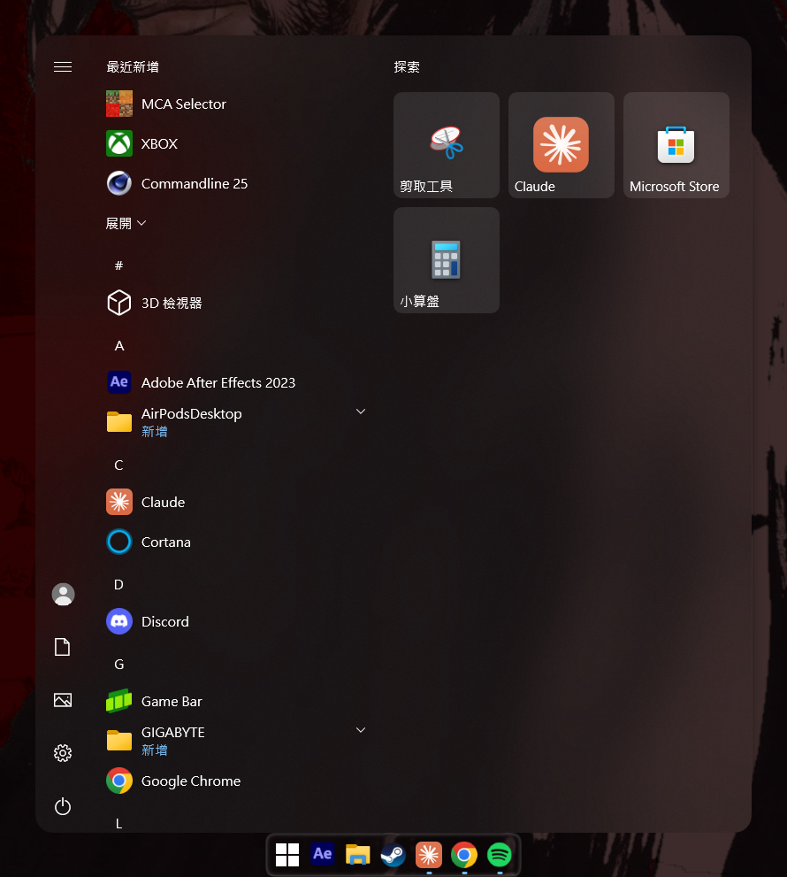
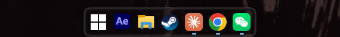
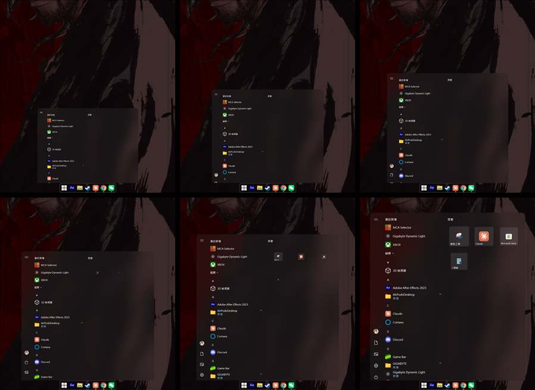

# GlassDock

把 Windows 10 的工作列變成 Windows 11 的樣子，並在圖示後面放一條液態玻璃 Dock。
A Windows 11 style taskbar for Windows 10, with a liquid-glass dock behind the icons.

[English](#english) · [授權 MIT](LICENSE)

<p align="center"></p>
<p align="center"></p>

## 功能

- **置中**：開始按鈕和工作列圖示置中。按鈕是方形的，圖示間距 10 px，開始按鈕換成純白的 Windows 11 圖示。
- **液態玻璃 Dock**：圖示後面一條玻璃底座，有折射、色散、邊緣光和陰影。開關應用時，Dock 會伸縮，整排圖示會一起滑到新的置中位置。
- **高亮**：滑鼠移過圖示時是白色圓角方框，目前使用中的應用是玻璃選取框，兩者都用彈簧動畫在圖示之間滑動。
- **開始選單**：
  - 外觀是更透明的毛玻璃，Apple 式連續曲率圓角，裡面的按鈕、列表和磚塊統一圓角與間距。陰影也跟著圓角。
  - 打開時從 Dock 底下滑出、由窄變寬並淡入，磚塊接著逐一長出來。關閉時滑回 Dock 底下。
  - 開和關可以互相打斷：中途反向時，從當下的位置和速度接著走。

  

- **面板置中**：開始選單和搜尋面板都在螢幕中間打開。
- **乾淨退出**：結束或解除安裝時，工作列會還原成 Windows 原本的樣子。

## 需求

- Windows 10 x64。Windows 11 本來就是這個樣子，不支援。
- 工作列本身要透明。建議搭配 [TranslucentTB](https://github.com/TranslucentTB/TranslucentTB)，把各狀態都設成 Clear。
- 方形按鈕、Windows 11 開始圖示和 Dock 上的高亮，需要修改 Explorer 的程式碼。這部分只在 explorer.exe **10.0.19045.2965**（Windows 10 22H2 的一個版本）上啟用；其他版本會自動跳過，置中、Dock、開始選單等其餘功能照常。

## 安裝

1. 從 [Releases](https://github.com/tien11668899/GlassDock/releases) 下載 `GlassDock-x.y.z.zip`，整個解壓縮。
2. 執行 `GlassDock.exe`，按「確定」。

它會裝到 `%LOCALAPPDATA%\Programs\GlassDock`，開機時自動啟動，也會出現在「設定 → 應用程式」。不需要系統管理員權限。

通知區域的 GlassDock 圖示有這些選項：開機時啟動、設定、重新啟動（套用設定）、結束（還原工作列）、解除安裝。

- **更新**：解壓新版，一樣執行 `GlassDock.exe`。設定會保留。
- **解除安裝**：圖示選單的「解除安裝」，或「設定 → 應用程式」。

> 程式沒有數位簽章，第一次執行時 SmartScreen 可能會警告（「其他資訊 → 仍要執行」）。GlassDock 會把 DLL 掛進 explorer.exe，也會用 XAML 診斷介面在開始選單的程序裡載入外掛，所以防毒軟體可能會起疑。原始碼都在這裡，可以自己建置。

## 設定

設定檔在安裝資料夾裡。從圖示選單的「設定」打開，改完選「重新啟動」套用。

`taskbar-dock.ini`（Dock）

| 鍵 | 預設 | 說明 |
| --- | --- | --- |
| `frost` | 2 | 玻璃的霧化（px，0–8） |
| `shadow` | 100 | 陰影強度（%，0–200） |
| `smoothing` | 60 | 圓角平滑度（%，0 = 圓弧，60 = iOS） |
| `period` | 380 | Dock 滑到新位置的時間（ms） |
| `fps` | 30 | Dock 後面的畫面變化時，每秒擷取幾次 |
| `log` | 0 | 1 = 寫入 `%TEMP%\taskbar-dock.log` |

`start-glass.ini`（開始選單）

| 鍵 | 預設 | 說明 |
| --- | --- | --- |
| `tint` | 12 | 壓克力的色調不透明度（%，Windows 原本約 90） |
| `luminosity` | 40 | 壓克力的亮度不透明度（%） |
| `radius` | 16 | 選單圓角（DIP，0 = 直角） |
| `smoothing` | 60 | 圓角平滑度（%） |
| `inner_radius` | 8 | 選單內按鈕、列表、磚塊的圓角（0 = 不改） |
| `nav_inset` | 8 | 左側導覽按鈕內縮 |
| `row_gap` | 4 | 列表高亮之間的間距 |
| `tile_gap` | 8 | 磚塊間距（Windows 原本 4） |
| `row_trim` | 2 | 列表高亮右側縮短 |
| `tile_shift` | 2 | 磚塊左移 |
| `targets` | AcrylicBorder | 要改的元素名稱，逗號分隔（空白 = 所有壓克力背景） |
| `open` | 1 | 0 = 用 Windows 原本的開啟動畫 |
| `cascade` | 1 | 0 = 磚塊不逐一長出 |
| `shadow_blur` | 14 | 選單陰影（跟選單一樣的圓角）的模糊（DIP，0 = 用 Windows 原本的直角陰影） |
| `shadow_drop` | 2 | 陰影往下偏移（DIP） |
| `shadow_opacity` | 45 | 陰影濃度（%） |
| `log` | 0 | 1 = 寫入開始選單程序暫存資料夾裡的 `start-glass.log` |

## 運作方式

| 元件 | 語言 | 做什麼 |
| --- | --- | --- |
| `GlassDock.exe` | Rust（無第三方套件） | 用 WinEvent 監看工作列和面板，用 MSAA 量圖示、UI Automation 量開始選單，把開始按鈕、圖示和面板置中。另外負責安裝與通知區域圖示。 |
| `taskbar_hooks.dll` | Rust | 用 `SetWindowsHookEx(WH_GETMESSAGE)` 只載入 Explorer 的工作列執行緒。只有在 explorer.exe 的時間戳、大小和每個要改的函式開頭都吻合時，才 patch `CTaskListWnd::_HandleThemeChanged`、`CPearl::_GetColorizedBitmap` 和幾個繪圖步驟；卸載時把原始位元組放回去。 |
| `taskbar-dock.dll` | C++/WinRT、D3D11 | 用 Magnification API 擷取 Dock 後面的桌面（排除工作列），以玻璃 shader 畫進 composition swap chain，並負責高亮和滑動的彈簧動畫。 |
| `start-glass.dll` / `start-glass.exe` | C++/WinRT | 透過 XAML 診斷介面（`InitializeXamlDiagnosticsEx`）以 TAP 形式載入 StartMenuExperienceHost，調整壓克力、圓角、間距和開啟動畫。關閉動畫由 Dock 用選單的截圖播放，兩邊透過視窗屬性共用同一條彈簧。 |

## 從原始碼建置

需要：

- Rust stable（`x86_64-pc-windows-msvc`）。
- Visual Studio 2022 或 Build Tools，含「使用 C++ 的桌面開發」和 Windows 10/11 SDK。

```powershell
powershell -ExecutionPolicy Bypass -File build.ps1
```

產出 `dist\GlassDock\` 和 `dist\GlassDock-x.y.z.zip`。`tools\make-icons.ps1` 會重畫圖示。`tools\disasm` 是找 Explorer 函式位置時用的小型反組譯工具（讀 PDB）。

## 致謝

- 玻璃效果來自 [S1mp1e](https://github.com/tien11668899/S1mp1e) 的液態玻璃 shader（`glass.fsh`），它依循 reglass 和 iyinchao 的 liquid-glass-studio 模型。
- 置中和開始選單外掛的做法參考了 TaskbarX、TranslucentSM 和 TranslucentTB。

---

## English

GlassDock makes the Windows 10 taskbar look like the Windows 11 one, and puts a liquid-glass dock behind the icons.

**Features**

- **Centred row.** Start and the taskbar icons are centred. Buttons are square with 10 px gaps between the icons, and the Start button gets a pure-white Windows 11 logo.
- **Liquid-glass dock.** A glass base behind the icons, with refraction, dispersion, a Fresnel rim and a shadow. When apps open or close, it stretches and the whole row glides to its new centred place.
- **Highlights.** The hover highlight is a white rounded square and the active app gets a glass selection. Both slide from icon to icon on springs.
- **Start menu.**
  - More see-through frosted acrylic, with Apple-style continuous-curvature corners (the shadow follows them too) and one radius and spacing for everything inside.
  - It slides out from under the dock as it opens, growing from the dock's width and fading in, and then its tiles grow in. It slides back under the dock as it closes.
  - Opening and closing interrupt each other smoothly: a reversal carries on from the current position and speed.
- **Centred panels.** The Start menu and the Search pane open centred.
- **Clean exit.** Quitting or uninstalling puts the taskbar back exactly as Windows has it.

**Requirements**

- Windows 10 x64. Windows 11 already looks like this and is not supported.
- A transparent taskbar. [TranslucentTB](https://github.com/TranslucentTB/TranslucentTB) with every state set to Clear is recommended.
- Square buttons, the Windows 11 Start logo and the dock's highlights patch Explorer's code. That part is enabled only on explorer.exe **10.0.19045.2965** (a Windows 10 22H2 build). On other builds it stays out of Explorer, and everything else still works.

**Install**

1. Download `GlassDock-x.y.z.zip` from [Releases](https://github.com/tien11668899/GlassDock/releases) and extract the whole zip.
2. Run `GlassDock.exe` and confirm.

It installs into `%LOCALAPPDATA%\Programs\GlassDock`, starts with Windows and shows up in Settings → Apps. No administrator rights are needed.

Its notification-area icon has these items: Start with Windows, Settings, Restart (applies the settings), Quit (restores the taskbar) and Uninstall.

- **Update:** run the new `GlassDock.exe` the same way. Your settings are kept.
- **Uninstall:** use the icon's menu, or Settings → Apps.

> The binaries are not code-signed, so SmartScreen may warn on first run (More info → Run anyway). GlassDock hooks a DLL into explorer.exe and loads a XAML Diagnostics extension into the Start menu's process, which antivirus software may find suspicious. All of the source is here, so you can build it yourself.

**Settings** live in the install folder. Open them from the icon's Settings menu, and choose Restart to apply them. The keys are listed in the two tables above.

**How it works**

- **`GlassDock.exe`** (Rust, no crates) follows the taskbar and the panels through WinEvents. It measures the icons with MSAA and the Start menu with UI Automation, and centres Start, the icons and the panels. It also handles installing and the notification-area icon.
- **`taskbar_hooks.dll`** (Rust) is loaded only into Explorer's taskbar thread, through a WH_GETMESSAGE hook. It patches `CTaskListWnd::_HandleThemeChanged`, `CPearl::_GetColorizedBitmap` and a few drawing steps, but only when the explorer.exe time stamp, image size and every patched prologue match. It restores the original bytes when it unloads.
- **`taskbar-dock.dll`** (C++/WinRT and D3D11) captures the desktop behind the dock with the Magnification API, leaving out the taskbar. It renders the glass shader into a composition swap chain and runs the highlight and glide springs.
- **`start-glass.dll` / `.exe`** (C++/WinRT) is a TAP loaded into StartMenuExperienceHost through XAML Diagnostics (`InitializeXamlDiagnosticsEx`). It tunes the acrylic, corners and spacing, and runs the opening animation. The closing animation is the dock playing a picture of the menu, and the two sides share one spring through window properties.

**Build:** Rust stable (MSVC) and Visual Studio 2022 or its Build Tools with C++ and a Windows 10/11 SDK. Run `powershell -ExecutionPolicy Bypass -File build.ps1`, which writes `dist\GlassDock\` and the release zip.

**Credits:**

- The glass is [S1mp1e](https://github.com/tien11668899/S1mp1e)'s liquid-glass shader (`glass.fsh`), which follows reglass and iyinchao's liquid-glass-studio.
- TaskbarX, TranslucentSM and TranslucentTB showed the way for the centring and the Start menu extension.

**License:** [MIT](LICENSE)
